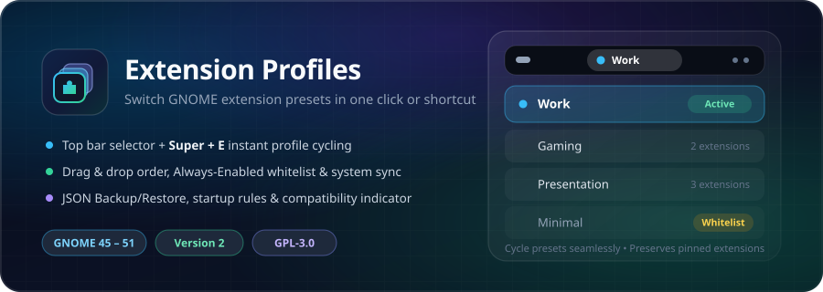
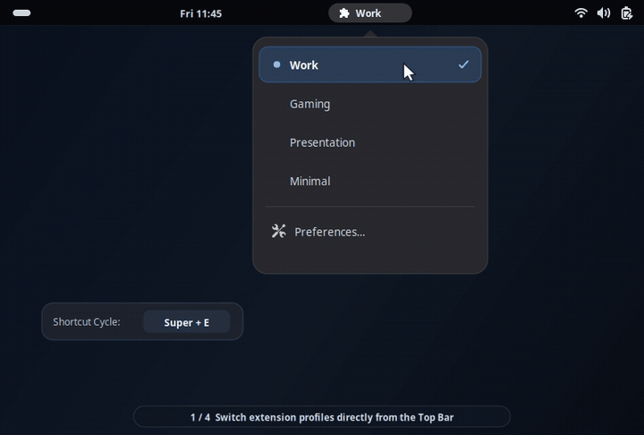
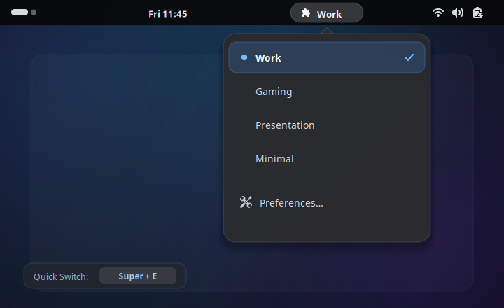
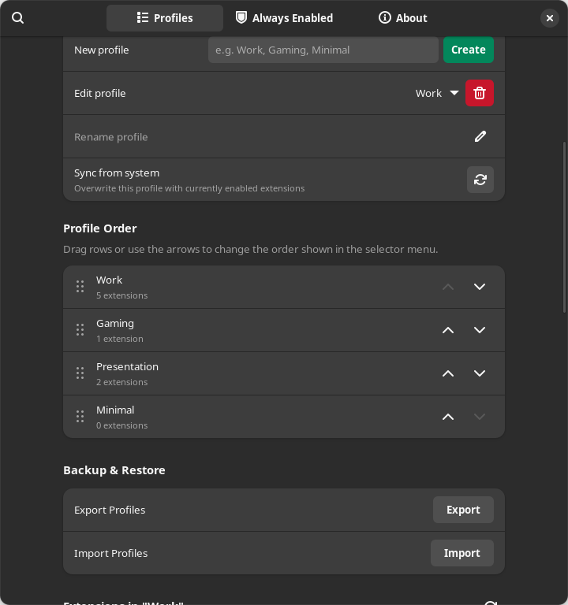
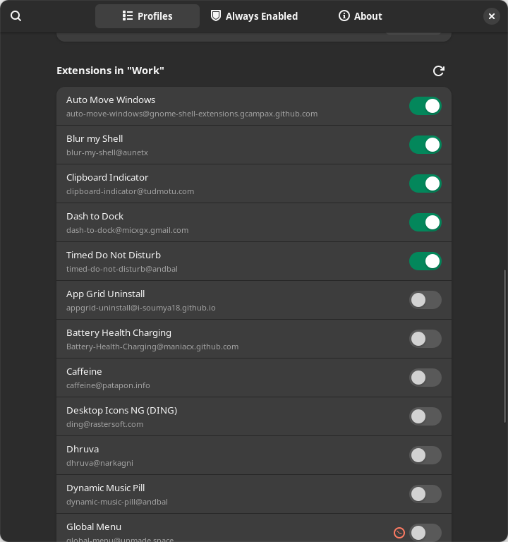
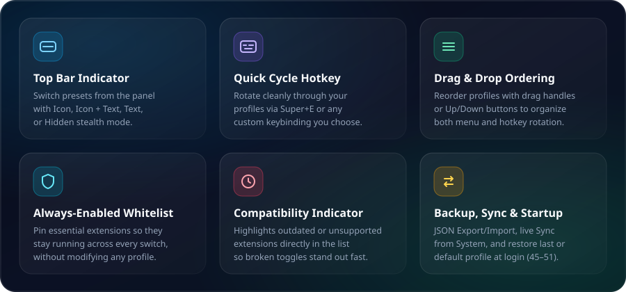

<div align="center">

<picture>
  <source media="(prefers-color-scheme: dark)" srcset="screenshots/banner.svg">
  <source media="(prefers-color-scheme: light)" srcset="screenshots/banner.svg">
  
</picture>

<br/><br/>

# Extension Profiles

**Save, organize, and switch curated GNOME extension presets with one click or shortcut.**

<p>
  <a href="https://extensions.gnome.org/extension/9545/extension-profiles/">
    
  </a>
</p>

<p>
  
  [](https://extensions.gnome.org/extension/9545/extension-profiles/)
  
  
  
  
</p>

</div>

---

## Preview

<div align="center">
  
</div>

<br/>

<table>
  <tr>
    <td align="center" width="33%">
      
      <br/>
      <sub><b>Top Bar Profile Menu</b><br/>One-click switching &amp; Super + E cycling</sub>
    </td>
    <td align="center" width="33%">
      
      <br/>
      <sub><b>Management &amp; Ordering</b><br/>Drag &amp; drop order, sync &amp; JSON backup</sub>
    </td>
    <td align="center" width="33%">
      
      <br/>
      <sub><b>Extensions &amp; Whitelist</b><br/>Per-profile toggles &amp; incompatible indicator</sub>
    </td>
  </tr>
</table>

---

## Features

<div align="center">
  
</div>

<br/>

- **Top Bar Selector** — Switch between Work, Gaming, Presentation, or custom profiles directly from the GNOME panel (`Icon only`, `Icon + Text`, `Text only`, or `Hidden`).
- **Quick Cycle Hotkey** — Rotate through your configured profiles anytime using a customizable keyboard shortcut (`Super + E` by default).
- **Drag & Drop Profile Ordering** — Reorder profiles cleanly by dragging rows or clicking Up/Down arrows; changes appear immediately in the menu and hotkey rotation.
- **Always-Enabled Whitelist** — Pin core extensions (e.g. dock, clipboard, theme tweaks) so they stay active regardless of which profile you switch to.
- **Compatibility Indicator & Sync** — Highlights extensions incompatible with your GNOME Shell version directly in the list, plus **Sync from system** to snapshot currently enabled extensions.
- **Backup, Restore & Startup** — Export/import all profiles and whitelist settings as JSON, and optionally apply a default profile or restore the last active profile at login.

---

## Installation

### Recommended (GNOME Extensions / Extension Manager)
- Visit **[Extension Profiles on GNOME Extensions](https://extensions.gnome.org/extension/9545/extension-profiles/)** and toggle it **On**.
- Or search **Extension Profiles** in the **Extension Manager** desktop app and click **Install**.

### From Source
```bash
git clone https://github.com/Andbal23/extension-profiles.git
cd extension-profiles
glib-compile-schemas schemas/
gnome-extensions pack --force --extra-source=icons --extra-source=LICENSE
gnome-extensions install --force extension-profiles@andbal.shell-extension.zip
```
Log out and log back in (or restart your GNOME session on Wayland), then enable the extension:
```bash
gnome-extensions enable extension-profiles@andbal
```

---

## More Extensions

- **[Timed Do Not Disturb](https://extensions.gnome.org/extension/9550/timed-do-not-disturb/)** — Silence notifications for custom countdowns or until a set wake-up time.
- **[Dynamic Music Pill](https://github.com/Andbal23/dynamic-music-pill)** — Smooth MPRIS music pill, visualizer & media controls for the GNOME top bar.

---

<div align="center">

### Support

If Extension Profiles streamlines your GNOME workflow, consider supporting its development:

<p>
  <a href="https://buymeacoffee.com/Andbal23">
    
  </a>
  <a href="https://ko-fi.com/Andbal23">
    
  </a>
</p>

<br/>

<a href="https://star-history.com/#Andbal23/extension-profiles&Date">
  
</a>

<br/><br/>

<sub>Released under the <a href="LICENSE">GPL-3.0 License</a> • Built for GNOME Shell 45 – 51</sub>

</div>
